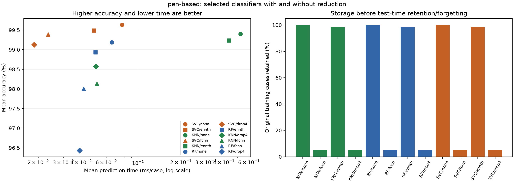

# Tabular ML Benchmark

**How much accuracy do we trade for faster predictions and a smaller training set?**

A reproducible comparison of **Random Forest, SVC and a custom k-nearest neighbour classifier**, with **FCNN, ENNTh and DROP4** instance reduction. It measures accuracy, prediction time, retained training instances and preparation cost, then compares candidates with Friedman tests and Holm-adjusted post-hoc tests.

[Read the report](reports/report.pdf) · [Explore results](docs/results.md) · [Run experiments](docs/cli.md) · [Statistical method](docs/statistical-analysis.md)

## What is included

- Custom kNN with four distances, two voting rules and four retention policies.
- Scikit-learn SVC and Random Forest, evaluated through the same harness.
- Three training-set reduction methods, evaluated with every selected classifier.
- Original ten-fold splits, parameter grids and per-fold measurements.
- Two-stage analysis: select configurations, then compare 12 model/reduction combinations per dataset.
- A complete report, CSV tables, figures and automated checks.

## Results at a glance

These are **recorded reference results**, not timings from your machine. Accuracy is the mean ± sample standard deviation across ten folds.

| Dataset | Selected final candidate | Accuracy (%) | Mean time (ms/case) | Training cases retained (%) |
| --- | --- | ---: | ---: | ---: |
| Wine | SVC + ENNTh | 99.474 ± 1.664 | 0.011538 | 91.70 |
| Pen-based | SVC, no reduction | 99.636 ± 0.177 | 0.077301 | 100.00 |

Selection uses the highest mean accuracy, then lowest mean prediction time for an exact tie. It does **not** imply significant superiority over every alternative. On Wine, SVC with and without ENNTh tie in accuracy; their time difference is not significant after Holm correction.

On Pen-based, FCNN and DROP4 retain about 5% of the training set. They substantially reduce observed kNN prediction time, but also reduce accuracy. SVC offers smaller accuracy losses and significant prediction-time improvements under the implemented analysis. Reduction also takes time, so faster prediction does not automatically mean a faster complete workflow.



See [all 24 final candidates and their costs](docs/results.md). The [report](reports/report.pdf) contains the full analysis and discussion.

## Quick start

Use **Python 3.11**:

```bash
git clone https://github.com/MRH73/tabular-ml-benchmark.git
cd tabular-ml-benchmark
python3.11 -m venv .venv
source .venv/bin/activate
python -m pip install -r requirements.txt
```

On Windows, activate with `.venv\Scripts\Activate.ps1` in PowerShell. Run commands from the repository root.

Run a small SVC experiment on one Wine fold:

```bash
python src/harness.py experiment --model-type svc --dataset wine --folds 0
```

Check the full plan without training or writing outputs, then run it:

```bash
python src/harness.py all --dry-run
python src/harness.py all
```

New outputs go to **`runs/latest/results/`** and **`runs/latest/selections/`**, ignored by Git. Committed measurements in **`results/reference/`** remain separate. Commands refuse to overwrite completed outputs; use fresh directories for another run. The small experiment writes into an `experiments/` subfolder and does not conflict with the full workflow.

The full Pen-based grid can take hours, especially with IVDM and retention. Start with the small example or `all --dataset wine`. [The execution guide](docs/cli.md) explains stages, progress, macOS `caffeinate` and rebuilding the statistics without retraining.

## Project layout

```text
src/                     Harness, classifiers, reducers and statistics
configs/                 Shared parameter grids: RF, SVC and kNN
data/                    Wine and Pen-based: ten train/test splits each
results/reference/       Recorded measurements, analyses, figures and selections
reports/report.pdf       Full collaborative report, unchanged
docs/                    Commands, methods, results and verification notes
tests/                   Data, statistics and pipeline checks
runs/                    Local outputs (created on demand; ignored by Git)
```

`src/harness.py` is the entry point. RF and SVC constructors are in `src/rf_classifier.py` and `src/svc_classifier.py`; the custom classifier is in `src/knn_classifier.py`. [Complete code map](docs/architecture.md).

## Datasets and evaluation

**Wine:** 178 examples, 13 numeric features, three cultivar classes. This is Wine classification, **not Wine Quality**. **Pen-based:** 10,992 digit examples, 16 numeric features, ten classes. Included ARFF files preserve the exact splits used for the report. [Descriptions and attribution](data/README.md).

Scaling, imputation and reduction use training data only. The recorded run uses `clip=False`, seed 42 and ENNTh `mu=0.8`. Each metric and dataset is analysed separately; accuracy and time are never combined into one score.

Important limits:

- Folds share training observations. Using them as statistical blocks is an adaptation, not a comparison of independent datasets.
- Selection and final reporting reuse the same folds; this is not nested cross-validation or independent test evaluation.
- RF and SVC predict in batches. kNN processes cases sequentially, and retention policies receive each label after prediction. Time per case is throughput-based, not isolated-query latency.
- Time depends on hardware and load. Retained training instances are not fitted-model memory usage.

## Checks

```bash
python -m unittest discover -s tests -v
```

Checks cover preprocessing, folds, statistics, recorded-result consistency and a Wine pipeline with all three classifiers and reductions. GitHub Actions runs them on pushes and pull requests. [Verification scope](docs/verification.md).

## Credits

Maintained by **Miguel Ruiz** as a personal portfolio edition of a collaborative project.
