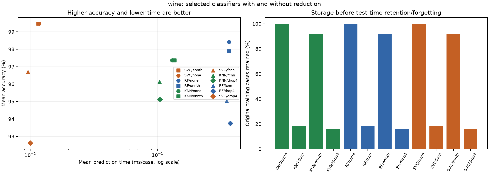

# Results for wine

Each row below uses the selected configuration of that classifier.
Accuracy and time are means over the ten original folds. Times are
milliseconds per case for processing the full test fold, not single-query latency.
RF and SVC predict in batches; kNN keeps its ordered retention/forgetting steps.

| Model | Reduction | Accuracy (%) | Time (ms/case) | Stored (%) | Reduction + fit (s) |
| --- | --- | ---: | ---: | ---: | ---: |
| svc | ennth | 99.474 | 0.011538 | 91.70 | 0.0050 |
| svc | none | 99.474 | 0.011745 | 100.00 | 0.0014 |
| rf | none | 98.421 | 0.365431 | 100.00 | 0.1370 |
| rf | ennth | 97.895 | 0.365500 | 91.70 | 0.1448 |
| knn | none | 97.368 | 0.130628 | 100.00 | 0.0006 |
| knn | ennth | 97.368 | 0.135894 | 91.70 | 0.0043 |
| svc | fcnn | 96.692 | 0.009595 | 18.28 | 0.1220 |
| knn | fcnn | 96.130 | 0.103816 | 18.28 | 0.1216 |
| knn | drop4 | 95.110 | 0.104696 | 16.05 | 0.0543 |
| rf | fcnn | 95.019 | 0.350115 | 18.28 | 0.2384 |
| rf | drop4 | 93.744 | 0.374528 | 16.05 | 0.1792 |
| svc | drop4 | 92.622 | 0.010013 | 16.05 | 0.0548 |

The observed selection is **svc with ennth**.
The rule is highest mean accuracy, using lower mean time only for an exact tie.
This choice alone does not prove that it beats every other candidate.

| Metric | Friedman permutation p-value | Difference detected at 0.05? |
| --- | ---: | --- |
| accuracy | 0.0018 | Yes |
| time_ms_per_instance | 0.0001 | Yes |

Friedman checks the whole group. When it rejects, `posthoc.csv` gives
the pairwise rank comparisons with Holm correction over all 66 pairs.
Accuracy and time are corrected separately. The post-hoc normal approximation
is a limitation with ten folds; the omnibus uses 9,999 permutations.

A non-significant comparison does not prove equal performance. In particular,
do not call a faster candidate equally accurate just because a difference was not detected.

The fold convention follows the agreement with the professor. Training folds overlap,
and selection uses these same folds, so this is not an independent final evaluation.

Read `summary.csv` for fold standard deviations, average ranks, the fastest
candidate and the number of significant rank comparisons each candidate wins.
Read `chosen.csv` for the full selected parameters without an ID.

